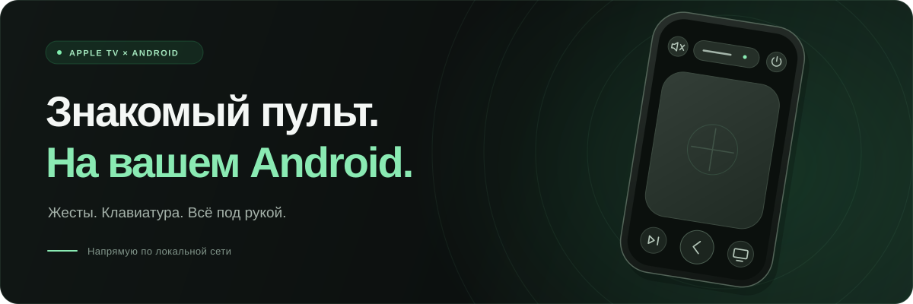
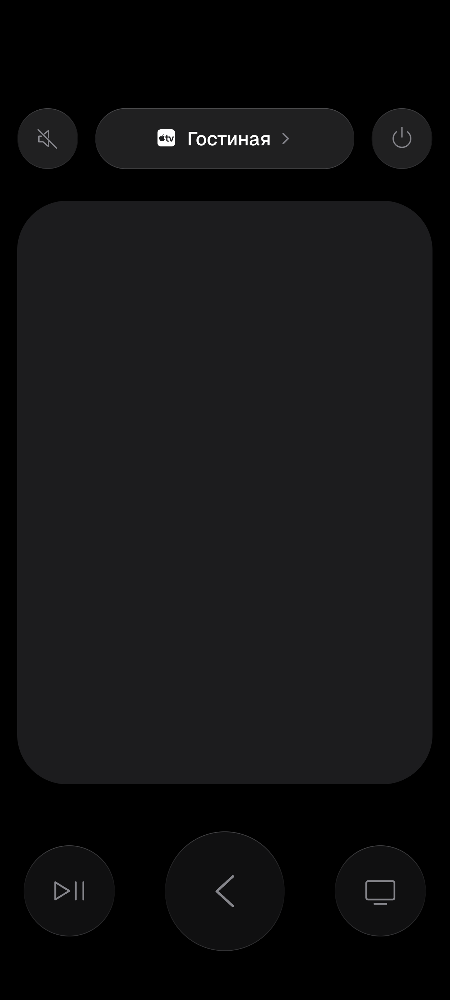
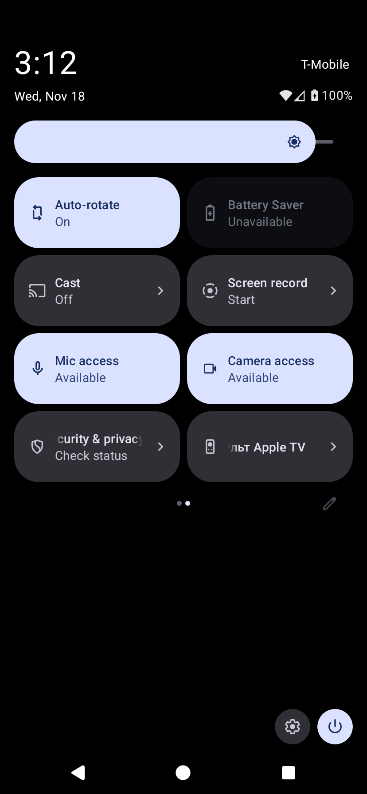

<p align="center">
  
</p>

<h1 align="center">Remote Apple TV</h1>

<p align="center">
  Сенсорный пульт для Apple TV на Android.<br>
  Жесты, кнопки и клавиатура телефона — в лаконичном тёмном интерфейсе.
</p>

<p align="center">
  <a href="#сборка"></a>
  <a href="#совместимость"></a>
  
  
</p>

<p align="center">
  <a href="#возможности">Возможности</a> ·
  <a href="#подключение">Подключение</a> ·
  <a href="#управление">Управление</a> ·
  <a href="#сборка">Сборка</a> ·
  <a href="docs/DEVELOPMENT.md">Разработчикам</a>
</p>

---

## Интерфейс

Большая сенсорная область, знакомое расположение кнопок и быстрый запуск из шторки Android.

<p align="center">
  
  &nbsp;&nbsp;&nbsp;&nbsp;
  
</p>

<p align="center">
  <sub>Экран пульта и плитка в быстрых настройках. Скриншоты из приложения.</sub>
</p>

## Возможности

- **Навигация жестами.** Свайпы, касания и удержания на большой сенсорной области.
- **Основные команды под рукой.** Воспроизведение, пауза, «Назад», «Домой», переключение приложений и Пункт управления.
- **Клавиатура телефона.** Ввод текста, включая русский, в активное поле на Apple TV.
- **Звук и питание.** Клавиши громкости телефона, отключение звука, включение и переход в сон. Управление звуком зависит от аудиовыхода.
- **Удобное подключение.** Автопоиск в локальной сети, поиск по IPv4-адресу и повторное подключение к последнему устройству.
- **Плитка в шторке.** Открытие пульта из быстрых настроек Android.

Приложение связывается с Apple TV напрямую по локальной сети. Сетевой движок встроен в APK; отдельный сервер, аккаунт и Home Assistant для работы не нужны.

## Подключение

Понадобятся телефон с **Android 8.0+**, **Apple TV HD или Apple TV 4K** и общая локальная сеть.

1. **Установите приложение.** [Соберите APK](#сборка), перенесите `app-debug.apk` на телефон и откройте его для установки. Это отладочная сборка; при запросе Android разрешите установку из используемого источника.
2. **Выберите телевизор.** Откройте пульт → **«Выбрать TV»** → ваш Apple TV.
3. **Введите PIN.** Четыре цифры появятся на экране телевизора. Сопряжение сохранится для следующих подключений.
4. **Добавьте быстрый доступ.** В меню устройств нажмите **«Добавить в быстрые настройки»**. На Android 13+ появится системное предложение; на Android 8–12 добавьте плитку через редактирование шторки.

**Хотите сначала посмотреть интерфейс?** Выберите **«Посмотреть интерфейс»** в меню устройств. В этом режиме команды на телевизор не отправляются.

<details>
<summary><strong>Apple TV не появляется в списке</strong></summary>

- Убедитесь, что телефон и Apple TV находятся в одной локальной сети и телевизор доступен.
- Проверьте, что гостевая сеть или изоляция клиентов на роутере не мешают устройствам видеть друг друга.
- В меню пульта выберите **«Подключить по IP-адресу»**. IPv4-адрес телевизора указан в **Настройки → Сеть** на Apple TV.
- Дождитесь завершения текущего поиска и повторите попытку.

</details>

## Управление

| Элемент | Действие |
| :--- | :--- |
| Свайп по сенсорной области | Перемещение вверх, вниз, влево или вправо |
| Касание / удержание сенсорной области | Выбор / дополнительное действие |
| Воспроизведение | Воспроизведение или пауза |
| Назад | Предыдущий экран |
| Домой | Главный экран Apple TV |
| Двойное нажатие «Домой» | Переключение приложений |
| Удержание «Домой» | Пункт управления Apple TV |
| Питание | Выбор включения или перехода в сон |
| Звук | Отключение и восстановление ранее полученного уровня громкости, если аудиовыход поддерживает это |
| Клавиши громкости телефона | Громкость Apple TV, пока открыт пульт |
| Клавиатура | Ввод текста в активное поле; кнопка появляется при фокусе поля и доступна в меню |
| Удержание устройства в списке | Удаление сохранённого сопряжения |

При отправке текста содержимое активного поля на Apple TV заменяется введённым текстом.

## Совместимость

| Компонент | Поддержка |
| :--- | :--- |
| Телефон | Android 8.0+ · `arm64-v8a` или `x86_64` |
| Apple TV | HD и 4K с протоколом Companion |
| Сеть | Общая локальная сеть; автопоиск или поиск по IPv4 |
| Apple TV 2 / 3 | Не поддерживаются |
| Siri, голос и ИК-команды для телевизора | Не реализованы |
| Сенсорная область | Жесты преобразуются в отдельные команды навигации; непрерывный HID-трекпад iOS не реализован |

> **Статус версии 0.1.1.** Сборка, тесты транспорта и сценарии с симулятором проверены. Управление физическим Apple TV пока не подтверждено: во время последней проверки телевизор был недоступен в сети. Подробности — в [отчёте QA](docs/qa/0.1.1.md).

Интерфейс проверен в эмуляторе Android 16 и на Nothing A069P с Android 17. Более старые версии Android, `x86_64` и устройства со страницами памяти 16 КБ отдельно не проверялись.

## Данные и сопряжение

Ключи сопряжения хранятся в закрытом хранилище приложения, зашифрованном **AES-GCM** с ключом из **Android Keystore**. Резервное копирование и перенос этих данных отключены. PIN, введённый текст и ключи не выводятся в журналы приложения.

## Сборка

Нужны **JDK 21**, **Python 3.11** и **Android SDK Platform 36.1**. Gradle **9.6.0** запускается через wrapper из репозитория.

1. Откройте корневую папку в Android Studio.
2. Укажите путь к Android SDK и дождитесь синхронизации Gradle.
3. Выполните в корне проекта:

```sh
./gradlew :app:assembleDebug :app:lintDebug
```

Готовый APK: `app/build/outputs/apk/debug/app-debug.apk`. Он подписан отладочным ключом. APK-файлы исключены из Git через `.gitignore`.

Подготовка Python-окружения, тесты, QA-сборка и особенности зависимостей описаны в [руководстве разработчика](docs/DEVELOPMENT.md).

## Как это устроено

| Слой | Технология |
| :--- | :--- |
| Интерфейс | Kotlin, нативные Android Views и векторная графика |
| Поиск устройств | Android NSD / mDNS · `_companion-link._tcp` |
| Подключение и сопряжение | Companion через pyatv |
| Python внутри APK | Chaquopy |
| Хранение ключей | Android Keystore + AES-GCM |

## Проверки

Результаты последнего сохранённого прогона для версии **0.1.1**:

| Проверка | Результат |
| :--- | :--- |
| Сборки `debug` и `qa` | Успешно |
| Android Lint | 0 ошибок; по 3 предупреждения о версиях SDK и инструментов |
| Тесты транспорта | 28 / 28 |
| Сквозной тест с симулятором Companion | PIN, шифрование, 18 операций, русский текст и сохранение сопряжения |
| UI-сценарии на Nothing A069P | 14 / 14 |
| Плитка быстрых настроек | Добавление и запуск пульта из фона |

[Отчёт 0.1.1](docs/qa/0.1.1.md) · [Первичная проверка 0.1.0](docs/qa/0.1.0.md) · [Запуск тестов](docs/DEVELOPMENT.md#тесты-транспорта)

## Благодарности

Проект использует [pyatv](https://github.com/postlund/pyatv) и [Chaquopy](https://github.com/chaquo/chaquopy) под лицензией MIT, а также неизменённую pure-Python сборку [python-zeroconf](https://github.com/python-zeroconf/python-zeroconf) под LGPL-2.1-or-later. Лицензия zeroconf включена в wheel.

---

<p align="center">
  <sub>Независимый проект. Apple TV и Siri — товарные знаки Apple.</sub>
</p>
