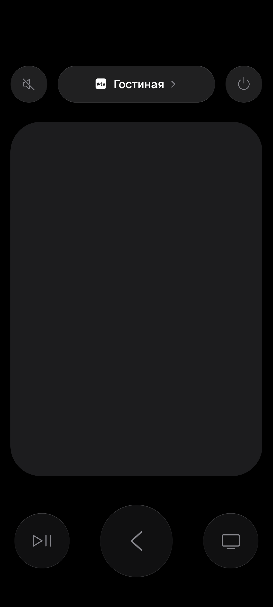
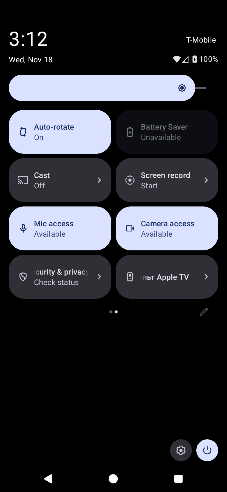

<h1 align="center">Remote Apple TV</h1>

  <strong>Привычный «Пульт» Apple TV — теперь на Android.</strong> 
  Повторяет тёмный дизайн, большую сенсорную область и расположение кнопок оригинального пульта на iPhone.

  <a href="README.md">English</a> · <strong>Русский</strong>

  
  

  <a href="APK/Remote-Apple-TV-1.0.apk?raw=true"><strong>Скачать APK · v1.0</strong></a>
   
  ARM64 / x86_64 · Сборка с отладочной подписью

  
  &nbsp;&nbsp;&nbsp;&nbsp;
  

  Скриншоты приложения с русским интерфейсом.

## Возможности

- Навигация жестами, воспроизведение и привычные кнопки «Домой» и «Назад».
- Ввод текста с клавиатуры телефона, включая русский.
- Управление громкостью, отключением звука и питанием.
- Плитка в быстрых настройках для мгновенного доступа.
- Автопоиск в сети, сохранение сопряжения и автоматическое переподключение.

Работает напрямую по локальной сети. Аккаунт, отдельный сервер и Home Assistant не нужны.

## Совместимость

**Android 8.0+** · **Apple TV HD / 4K** · **Общая локальная сеть**

Управление звуком зависит от аудиовыхода. Приложение повторяет дизайн оригинального пульта; непрерывный трекпад iOS, Siri и ИК-управление телевизором не поддерживаются.

---

  Независимый проект. Apple TV и Siri — товарные знаки Apple.

